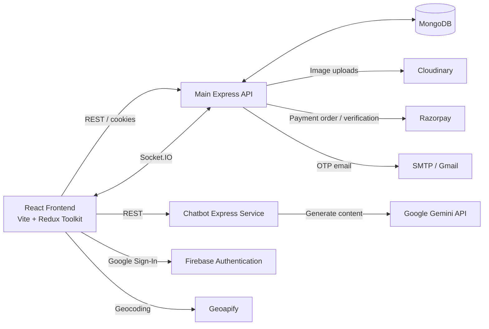

# Cravings — Real-Time Food Delivery Platform

A full-stack food delivery application built with the MERN stack. Cravings supports customer ordering, shop-owner operations, delivery-partner workflows, online payments, map-based delivery addresses, live delivery-location updates, and a Gemini-powered food assistant.

> **Repository:** [mohitkhatri031/cravings-mern-stack-food-delivery-app](https://github.com/mohitkhatri031/cravings-mern-stack-food-delivery-app)

## System Architecture

Cravings is organised as three independently runnable applications:

| Application | Responsibility | Local address |
|---|---|---|
| `frontend` | React single-page application for customers, shop owners, and delivery partners | `http://localhost:5173` |
| `backend` | Main Express API, MongoDB persistence, authentication, ordering, payments, uploads, and Socket.IO | `http://localhost:8000`* |
| `chatbot-backend` | Separate Express service that sends food-assistant prompts to Google Gemini | `http://localhost:5000` |

\* The frontend currently defines its main API base URL as `http://localhost:8000` in `frontend/src/App.jsx`. The API server defaults to port `5000`, so set `PORT=8000` in `backend/.env` for the current local configuration. The chatbot service uses port `5000` independently.



## Core Features

### Customer workflows
- Account registration and email/password sign-in.
- Google sign-in through Firebase Authentication.
- Password recovery using an email OTP with a five-minute expiry.
- Browse shops and food items by city; search items by name or category.
- Cart, checkout, order history, and order tracking.
- Select a delivery address using a map, current location, address search, or draggable map marker.
- Choose Cash on Delivery or online payment through Razorpay.
- View the assigned delivery partner and receive live location updates while an order is in transit.

### Shop-owner workflows
- Create or update a shop profile.
- Add, edit, and remove food items, including image uploads.
- View incoming orders and update shop-order status.
- Receive new-order events through Socket.IO.

### Delivery-partner workflows
- Maintain a location that can be queried using MongoDB geospatial operations.
- Receive nearby delivery assignments in real time.
- Accept an available assignment and retrieve the active delivery.
- Share GPS coordinates through Socket.IO for live tracking.
- Complete delivery after the customer-facing delivery OTP is verified.

### Payments and media
- Razorpay order creation on the server and server-side payment-status verification.
- Cash-on-Delivery checkout.
- Cloudinary image hosting; Multer handles incoming multipart image uploads.

### Gemini food assistant
- A separate Node.js/Express service exposes `POST /api/chat`.
- Google Gemini generates short food suggestions based on the assistant instructions, including menu, budget, dietary preference, and protein-related prompts.
- The chatbot service requests a structured JSON-style response containing a message and an optional suggested menu item.

## Technology Stack

| Layer | Technologies |
|---|---|
| Frontend | React 19, Vite 7, JavaScript, Tailwind CSS 4 |
| Client state and routing | Redux Toolkit, React Redux, React Router |
| HTTP and real-time client | Axios, Socket.IO Client |
| Maps and location | React Leaflet, Leaflet, Geoapify geocoding, OpenStreetMap tiles |
| Authentication | Firebase Authentication (Google sign-in), JWT-based application session, HTTP-only cookies |
| Main backend | Node.js, Express 5, MongoDB, Mongoose |
| Real-time communication | Socket.IO |
| Payments | Razorpay |
| File storage | Multer, Cloudinary |
| Email | Nodemailer (Gmail SMTP configuration) |
| AI assistant | Google Gemini API through `@google/genai` |

## Repository Structure

```text
cravings-mern-stack-food-delivery-app/
├── frontend/
│   ├── src/
│   │   ├── components/       # Reusable UI and tracking components
│   │   ├── hooks/            # Data-fetching and location hooks
│   │   ├── pages/            # Application pages and workflows
│   │   └── redux/            # Redux Toolkit store and slices
│   ├── firebase.js           # Firebase client initialisation
│   ├── package.json
│   └── vite.config.js
│
├── backend/
│   ├── config/               # Database configuration
│   ├── controllers/           # Authentication, user, shop, item and order logic
│   ├── middlewares/           # Authentication and upload middleware
│   ├── models/                # Mongoose schemas
│   ├── routes/                # Express API routes
│   ├── utils/                 # JWT, email and Cloudinary helpers
│   ├── index.js               # Main API entry point
│   ├── socket.js              # Socket.IO event handlers
│   └── package.json
│
├── chatbot-backend/
│   ├── server.js              # Gemini-powered chatbot API
│   └── package.json
│
└── README.md
```

## Application Design

### Authentication and session handling

- Passwords are hashed with `bcryptjs` before storage.
- The main backend issues a JWT after successful sign-up/sign-in and stores it in an HTTP-only cookie.
- Protected application routes use authentication middleware.
- Firebase handles the Google sign-in popup on the frontend; the frontend then calls the backend Google-auth route to establish the Cravings application session.
- Password recovery uses OTP generation, email delivery, OTP verification, and password reset.

### Order lifecycle and multi-shop orders

The order controller groups cart entries by shop before creating an order. A single checkout can therefore contain separate shop-order records. Each shop order carries its own items, subtotal, status, and delivery assignment.

Typical status progression:

```text
pending → preparing → out of delivery → delivered
```

For online checkout, the backend creates a Razorpay order. After checkout, the backend fetches the payment from Razorpay and marks the order as paid only when the payment status is `captured`.

### Delivery assignment and live tracking

1. A shop owner changes a shop order to `out of delivery`.
2. The backend queries delivery-partner users within a 5 km radius using MongoDB geospatial data and filters out partners with active assignments.
3. Available partners receive a `newAssignment` Socket.IO event and can accept the assignment.
4. The delivery partner sends location updates through the `updateLocation` socket event.
5. The server persists the latest GeoJSON coordinates and broadcasts `updateDeliveryLocation` events to connected clients.
6. The customer tracking page uses the latest coordinates to render the delivery partner on the map.
7. Delivery completion is confirmed using an OTP sent to the customer by email.

Important Socket.IO events used by the current implementation include `identity`, `updateLocation`, `updateDeliveryLocation`, `newOrder`, `newAssignment`, and `update-status`.

### Location and geospatial data

User locations are stored as GeoJSON `Point` coordinates in `[longitude, latitude]` order and indexed with a MongoDB `2dsphere` index. The checkout page uses Geoapify for address search and reverse geocoding, with Leaflet/OpenStreetMap for map display and marker interaction.

## Getting Started

### Prerequisites

- Node.js and npm.
- A MongoDB database (local MongoDB or MongoDB Atlas).
- Firebase project with Google sign-in enabled.
- Razorpay API credentials.
- Cloudinary account.
- Geoapify API key.
- Google Gemini API key.
- Gmail account configured to use an app password for SMTP email delivery.

### 1. Clone the repository

```bash
git clone https://github.com/mohitkhatri031/cravings-mern-stack-food-delivery-app.git
cd cravings-mern-stack-food-delivery-app
```

### 2. Configure the main backend

```bash
cd backend
npm install
```

Create `backend/.env`:

```env
PORT=8000
MONGODB_URL=your_mongodb_connection_string
JWT_SECRET=your_jwt_secret

RAZORPAY_KEY_ID=your_razorpay_key_id
RAZORPAY_KEY_SECRET=your_razorpay_key_secret

CLOUDINARY_CLOUD_NAME=your_cloudinary_cloud_name
CLOUDINARY_API_KEY=your_cloudinary_api_key
CLOUDINARY_API_SECRET=your_cloudinary_api_secret

EMAIL=your_gmail_address
PASS=your_gmail_app_password
```

Start the API:

```bash
npm run dev
```

The backend package runs `nodemon index.js`. The frontend currently calls the main API at `http://localhost:8000`; keep `PORT=8000` unless you also update the `serverUrl` constant in `frontend/src/App.jsx`. The API's CORS configuration currently allows `http://localhost:5173`.

### 3. Configure the chatbot service

Open a second terminal from the repository root:

```bash
cd chatbot-backend
npm install
```

Create `chatbot-backend/.env`:

```env
GEMINI_API_KEY=your_google_gemini_api_key
```

Start the chatbot service:

```bash
npm run dev
```

The chatbot service listens on port `5000` and exposes `POST /api/chat`.

### 4. Configure and start the frontend

Open a third terminal from the repository root:

```bash
cd frontend
npm install
```

Create `frontend/.env`:

```env
VITE_FIREBASE_APIKEY=your_firebase_web_api_key
VITE_GEOAPIKEY=your_geoapify_api_key
VITE_RAZORPAY_KEY_ID=your_razorpay_key_id
```

The Firebase project details other than the API key are currently defined in `frontend/firebase.js`. Ensure Google sign-in is enabled in the Firebase console and the local development domain is authorised.

Start the frontend:

```bash
npm run dev
```

Vite serves the frontend at `http://localhost:5173` by default.

## API Overview

The main API is prefixed with `/api`. Application routes other than the authentication endpoints use the `isAuth` middleware.

| Module | Method | Endpoint | Purpose |
|---|---|---|---|
| Auth | `POST` | `/api/auth/signup` | Register an account |
| Auth | `POST` | `/api/auth/signin` | Sign in with email and password |
| Auth | `GET` | `/api/auth/signout` | Clear the session cookie |
| Auth | `POST` | `/api/auth/google-auth` | Create/sign in to the application session after Google sign-in |
| Auth | `POST` | `/api/auth/send-otp` | Send password-reset OTP |
| Auth | `POST` | `/api/auth/verify-otp` | Verify password-reset OTP |
| Auth | `POST` | `/api/auth/reset-password` | Set a new password after OTP verification |
| User | `GET` | `/api/user/current` | Get the current authenticated user |
| User | `POST` | `/api/user/update-location` | Update the user's location |
| Shop | `POST` | `/api/shop/create-edit` | Create or update the owner's shop |
| Shop | `GET` | `/api/shop/get-my` | Get the current owner's shop |
| Shop | `GET` | `/api/shop/get-by-city/:city` | List shops in a city |
| Item | `POST` | `/api/item/add-item` | Add a food item (multipart image upload supported) |
| Item | `POST` | `/api/item/edit-item/:itemId` | Edit a food item |
| Item | `GET` | `/api/item/get-by-id/:itemId` | Get an item by ID |
| Item | `GET` | `/api/item/delete/:itemId` | Delete an item (current route implementation) |
| Item | `GET` | `/api/item/get-by-city/:city` | List items available in a city |
| Item | `GET` | `/api/item/get-by-shop/:shopId` | List items for a shop |
| Item | `GET` | `/api/item/search-items?query=...&city=...` | Search items by name/category within a city |
| Item | `POST` | `/api/item/rating` | Submit an item rating |
| Order | `POST` | `/api/order/place-order` | Create an order / Razorpay order |
| Order | `POST` | `/api/order/verify-payment` | Verify captured Razorpay payment |
| Order | `GET` | `/api/order/my-orders` | Get orders relevant to the authenticated role |
| Order | `GET` | `/api/order/get-assignments` | Get delivery assignments available to the delivery partner |
| Order | `GET` | `/api/order/get-current-order` | Get the delivery partner's active order |
| Order | `POST` | `/api/order/send-delivery-otp` | Send customer delivery OTP |
| Order | `POST` | `/api/order/verify-delivery-otp` | Verify OTP and complete delivery |
| Order | `POST` | `/api/order/update-status/:orderId/:shopId` | Update a shop-order status |
| Order | `GET` | `/api/order/accept-order/:assignmentId` | Accept a delivery assignment (current route implementation) |
| Order | `GET` | `/api/order/get-order-by-id/:orderId` | Get order details for tracking |
| Order | `GET` | `/api/order/get-today-deliveries` | Get today's completed deliveries for a delivery partner |
| Chatbot | `POST` | `http://localhost:5000/api/chat` | Generate a Gemini-powered food-assistant reply |

## Important Configuration Notes

- Keep all `.env` files out of version control. Never commit MongoDB credentials, JWT secrets, Razorpay secrets, Cloudinary secrets, email app passwords, or Gemini API keys.
- Frontend variables prefixed with `VITE_` are bundled into browser code. Treat them as client-side configuration, not secrets. Restrict provider keys by domain/API where supported.
- The main backend and Socket.IO CORS settings currently allow `http://localhost:5173`; update them for a different frontend origin or deployment domain.
- The main API base URL is currently hard-coded in `frontend/src/App.jsx`. Update it when deploying or changing the API host.
- The chatbot server currently listens on port `5000` in `chatbot-backend/server.js`.
- The main API's `PORT` should be `8000` for the current frontend configuration, even though the backend has a `5000` fallback when `PORT` is not set.

## Development Scripts

| Directory | Command | Description |
|---|---|---|
| `frontend` | `npm run dev` | Start Vite development server |
| `frontend` | `npm run build` | Build the frontend for production |
| `frontend` | `npm run lint` | Run ESLint |
| `frontend` | `npm run preview` | Preview the production build |
| `backend` | `npm run dev` | Start the main API with Nodemon |
| `chatbot-backend` | `npm run dev` | Start the chatbot service with Nodemon |
| `chatbot-backend` | `npm start` | Start the chatbot service with Node.js |

## Future Improvements

- Move service URLs and CORS origins into environment-based configuration.
- Add request validation and centralised error handling across API routes.
- Add automated tests for authentication, order creation, payment verification, and delivery assignment.
- Publish a formal OpenAPI specification for the REST endpoints.
- Add structured logging, rate limiting, and production deployment configuration.

## Author

**Mohit Khatri**  
[GitHub](https://github.com/mohitkhatri031) · [LinkedIn](https://www.linkedin.com/in/mohit-khatri-75b292322/)
